# Exercise 2 — Create, Deploy & Publish an MCP Server using SAP Integration Suite

## Overview

An AI agent is only as useful as the data it can reach. Getting it to enterprise data safely is the challenge.

In this exercise, you will wrap the Business Data Graph from [Exercise 1](../ex1/README.md) as an **MCP Server** — the standardized bridge between enterprise APIs and AI agents. You will deploy a MCP artifact, publish it as a product, and retrieve the OAuth credentials that authorize agent access.
By the end, your MCP Server is deployed, published and ready to be governed — ready for an AI agent to connect and consume in [Exercise 3](../ex3/README.md).

> [!NOTE]
> For a deeper understanding of the **Model Context Protocol (MCP)** and **MCP paradigm in SAP Integration Suite**, refer to [What is the Model Context Protocol (MCP)?](https://modelcontextprotocol.io/docs/2026-07-28/getting-started/intro) and [API-Centric Integration in SAP Integration Suite: A New Paradigm for API & MCP](https://community.sap.com/t5/technology-blog-posts-by-sap/api-centric-integration-in-sap-integration-suite-a-new-paradigm-for-api-amp/ba-p/14438245)

> [!IMPORTANT]
> Add your participant number to the end of every artifact you create. Wherever you see `XX` in the steps below, replace it with your assigned number (e.g. participant `03` uses `plantsupplyrisk_03` for the MCP Server, `plantsupplyriskProduct-03` for the Product, and `plantsupplyriskSubscription-03` for the Subscription).

## Ex. 2.1 — Create an Integration Package

### Step 1 — Navigate to Integrations and APIs

In SAP Integration Suite, go to **Design → Integrations and APIs**.

You will see a list of existing Integration Packages on the tenant.
 Click **Create**

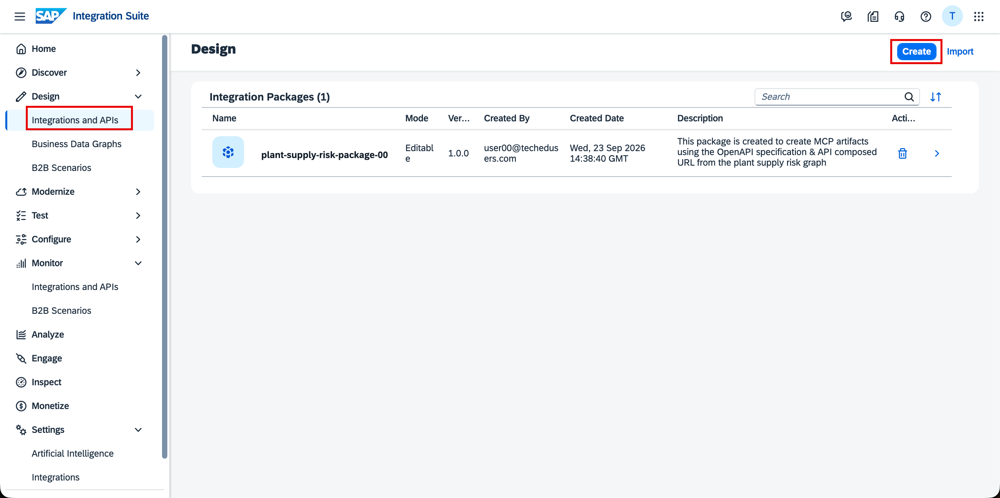

### Step 2 — Fill in Package Details

Fill in the following integration package details:

| Field | Value |
|---|---|
| Name | `plant-supply-risk-package-XX` (replace XX with your assigned participant number) |
| Technical Name | *(auto-populated)* |
| Short Description | `This package is created to create MCP artifacts using the OpenAPI specification & API composed URL from the plant supply risk graph` |
| Version | `1.0.0` |
| Vendor | `SAP` |

Click **Save**

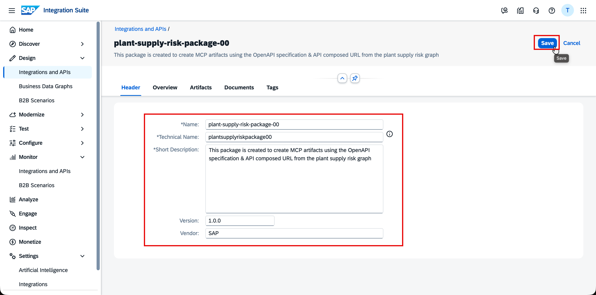

---

## Ex. 2.2 — Add MCP Server artifact

### Step 1 — Open the Artifacts Tab

After saving, you will land on the package detail page. Click the **Artifacts** tab.

Click **Add → MCP Server**.

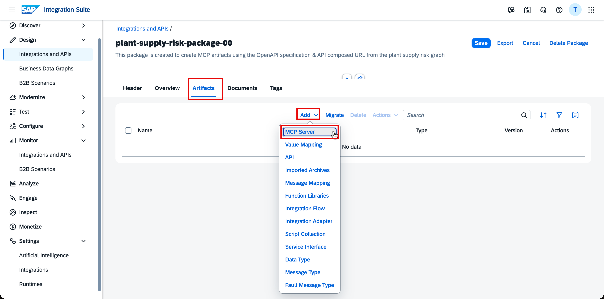

### Step 2 — Select Source Type

In the **Add MCP Server** wizard, select **HTTP Endpoint with OpenAPI Specification**.

> [!NOTE]
> This option creates an MCP Server from any HTTP endpoint by providing the URL and importing the OpenAPI Specification.

Click **Next**.

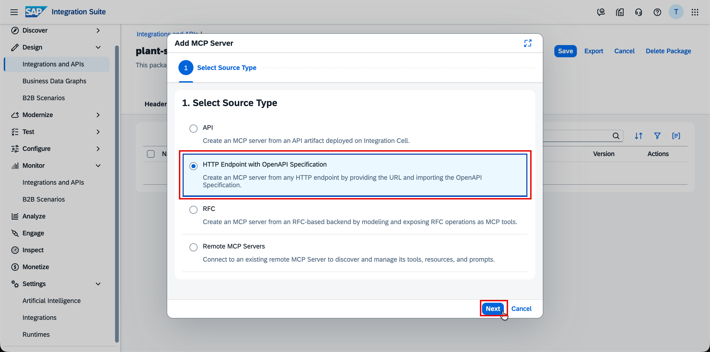

### Step 3 — Provide MCP Server Details

Fill in the following MCP Server details:

| Field | Value |
|---|---|
| Method | `Upload` |
| File Name | Upload the **OpenAPI Specification** file downloaded from the API Composition Navigator in [Ex. 1.5](../ex1/README.md#ex-15--explore-the-business-data-graph-via-api-composition-navigator) |
| Source | `URL` |
| URL | The **OData URL** copied from the Business Data Graph Overview in [Ex. 1.4](../ex1/README.md#ex-14--connect-the-model-extension-to-the-business-data-graph) |
| Name | `plantsupplyrisk_XX` (replace XX with your assigned participant number) |
| ID | `plantsupplyrisk_XX` (replace XX with your assigned participant number) |
| MCP Path | `/mcp-plantsupplyrisk-XX` (replace XX with your assigned participant number) |
| Version | `1.0.0` |
| Runtime Profile | `Integration Cell` |
| Virtual Host | *(auto-populated based on your tenant)* |

Click **Next**

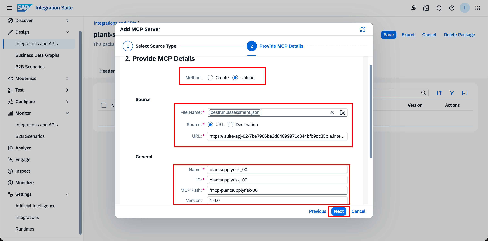

### Step 4 — Select Tools

The wizard reads your OpenAPI Specification and lists all available operations as **tools**.
 Select the following tools only, these tools would be exposed to the AI agent.

| Method | Path | Description | Select |
|---|---|---|---|
| GET | `/bestrun/assessment` | Retrieve a list of assessments | ✓ |
| GET | `/bestrun/assessment/{id}` | Retrieve a single assessment | ✓ |
| GET | `/bestrun/assessment/{id}/addressRisks` | Retrieve a list of address risks | ✓ |
| GET | `/bestrun/assessment/{id}/addressRisks/{addressId}...` | Retrieve a single address risk | ✓ |

Click **Add**.

> [!NOTE]
> The four tools selected above expose the assessment and address risk operations — the operations most relevant to the supply risk use case. Practitioners should select tools based on what the AI agent actually needs to answer business questions.

> [!NOTE]
> MCP servers can expose three types of primitives to AI agents. It is important to understand the difference when designing what your MCP Server exposes:
>
> | Primitive | What it is | In this MCP Server |
> |---|---|---|
> | **Tools** | Callable operations — the agent invokes a tool with parameters to fetch or act on data at runtime | ✓ The 4 operations selected above |
> | **Prompts** | Pre-defined prompt templates — guide how the agent uses the server's capabilities in a structured, repeatable way | — Not configured |
> | **Resources** | Readable reference content — the agent reads this as background context rather than invoking it as a function | — Not configured |
>
> This MCP Server exposes only **Tools**, generated directly from the OpenAPI Specification. Prompts and Resources can be configured separately to further guide agent behaviour.

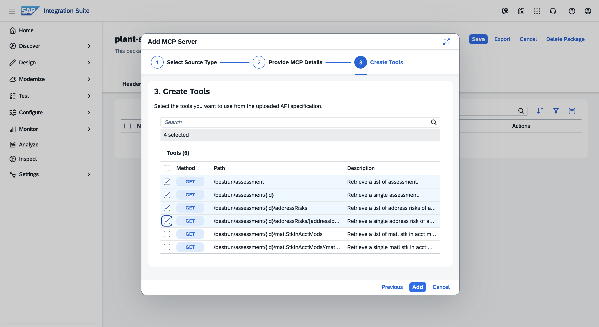
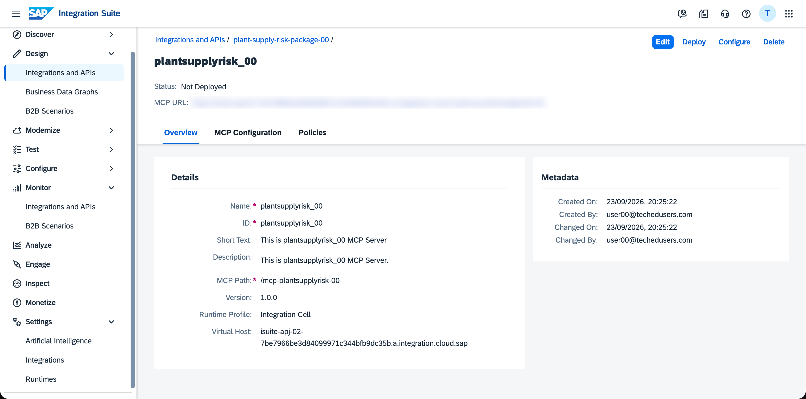

---

## Ex. 2.3 — Review and Configure the Policy Model

From the MCP Server detail page, click the **Policies** tab.

### Default Processing Flow

When an MCP Server is created, SAP Integration Suite automatically applies a default processing template. This template provides the runtime flow required to receive, authenticate, authorize, and forward requests to the backend service.

| Component | Role |
|---|---|
| **MCP Sender Adapter** | Entry point — exposes the managed MCP endpoint and receives requests from AI agents |
| **Authentication** | Verifies the identity of the API consumer. Supports Basic Authentication, OAuth 2.0, Client Certificate, and External OAuth (OIDC) for token validation from external identity providers such as Microsoft Entra ID, Google, and Okta. Multiple methods can be enabled simultaneously. |
| **Authorization** | Determines whether the authenticated caller is permitted to invoke the API |
| **HTTP Receiver Adapter** | Forwards the request to the backend service and returns the response through the same pipeline |

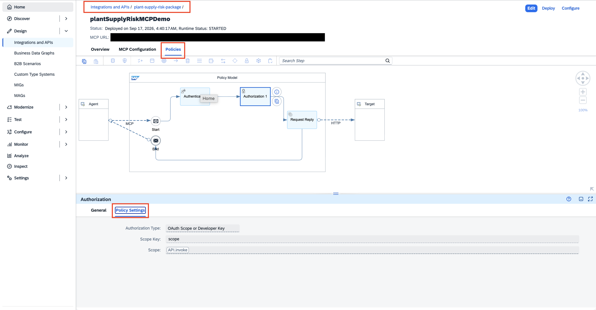

Click **Edit** in the top-right to enter edit mode.

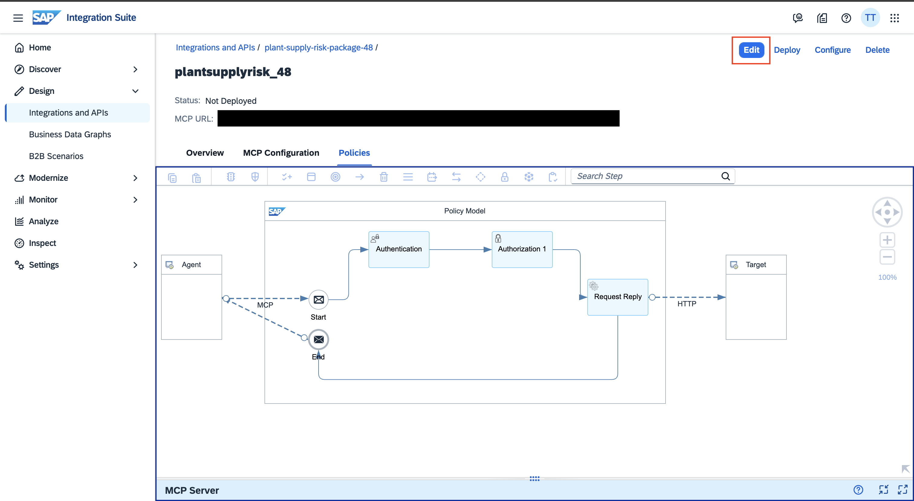

### Step 1 — Add Surge Protection

Click the **sequence flow** — the line connecting **Authorization 1** and **Request Reply**. A **+** button appears on it. Click **+**.

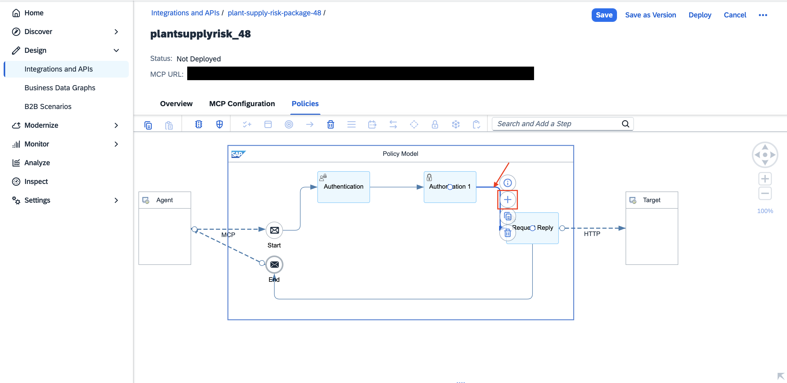

The **Add Flow Step** panel opens. Under **Traffic Management**, select **Surge Protection**.

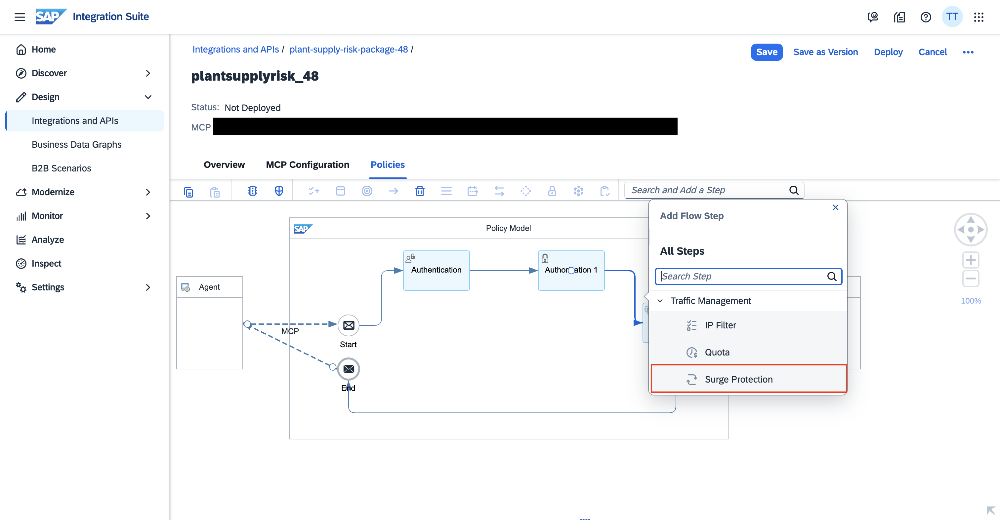

The **SurgeProtection 1** node is inserted. Click the node — the settings panel appears at the bottom. Drag the panel up using the handle (**⋮⋮⋮**) to expand it, then select the **Configure** tab. Fill in:

| Field | Value |
|---|---|
| Calls | `3` |
| Duration | `9` |
| Duration Unit | `Seconds` |

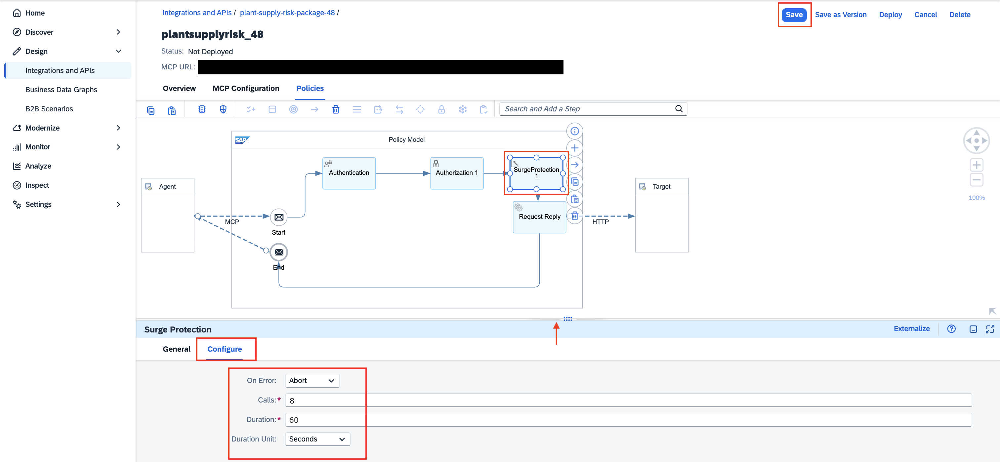

> [!NOTE]
> The supported duration range is 200 milliseconds to 9 seconds. With these settings, more than 3 calls within any 9-second window returns a `429 Too Many Requests` and the request is stopped before reaching the backend.

### Step 2 — Add Quota Management

Click the **sequence flow** — the line connecting **SurgeProtection 1** and **Request Reply**. A **+** button appears on it. Click **+**.

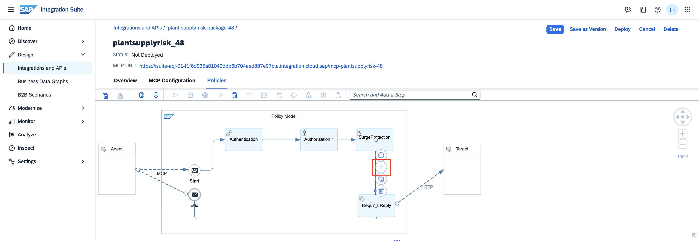

The **Add Flow Step** panel opens. Under **Traffic Management**, select **Quota**.

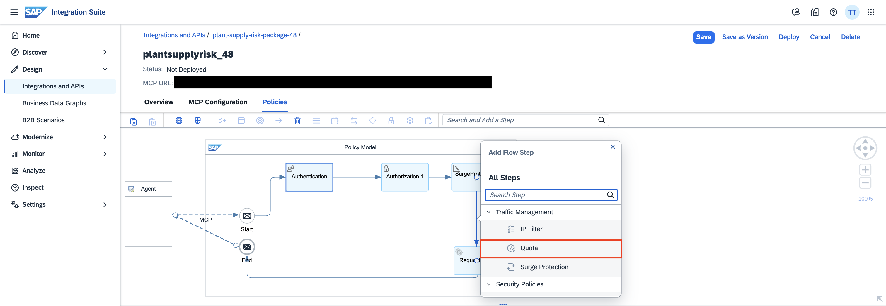

The **Quota 1** node is inserted. Click the node — the settings panel appears at the bottom. Drag the panel up using the handle (**⋮⋮⋮**) to expand it, then select the **Policy Settings** tab. Fill in:

| Field | Value |
|---|---|
| Mode | `Calendar` |
| Start Time (UTC) | Select a date at least one week in the past |
| Calls | `15` |
| Duration | `1` |
| Duration Unit | `Days` |

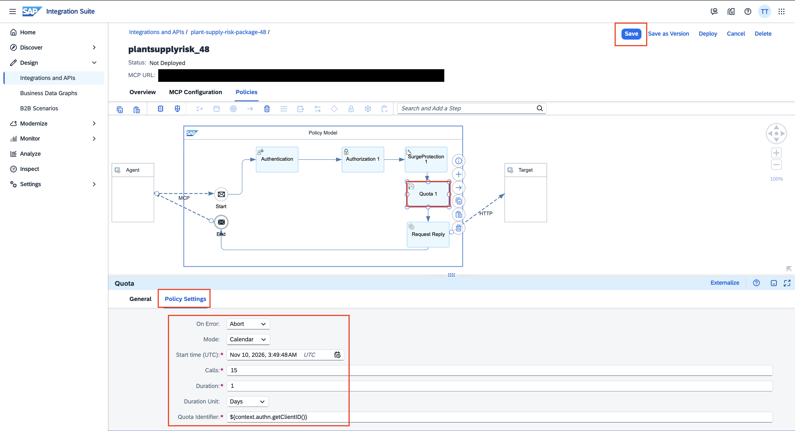

The final policy flow is:

**Agent → Authentication → Authorization 1 → Surge Protection → Quota → Request Reply → Target**

Click **Save** to save the policy updates.

With both Traffic Management policies saved, return to the **Overview** tab and proceed to deployment in Ex. 2.4.

---

## Ex. 2.4 — Deploy the MCP Server

### Step 1 — Click Deploy

From the MCP Server detail page, click **Deploy** in the top-right.

A confirmation dialog will appear:

| Field | Value |
|---|---|
| Runtime Profile | `Integration Cell` |
| Virtual Host | *(auto-populated based on your tenant)* |

Click **Deploy** to confirm.
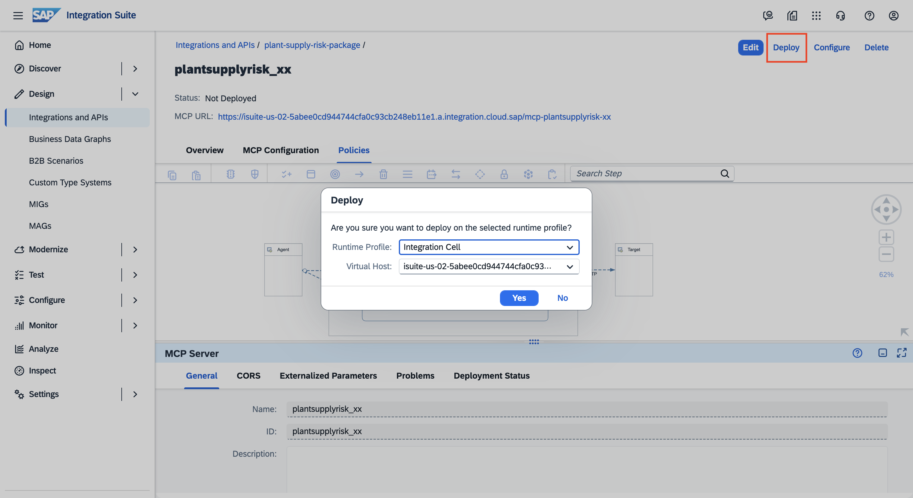

### Step 2 — Verify Deployment Status

Wait for the status to update. When deployment completes successfully, the status bar will show:

**Deployed on \<date\>\<time\>, Runtime Status: STARTED**

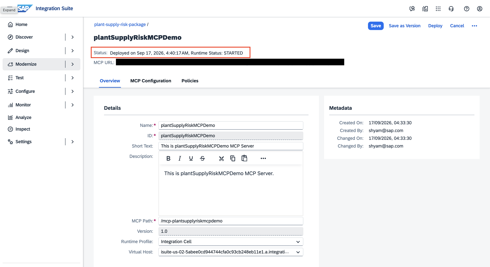

> [!NOTE]
> Note the **MCP URL** shown on this page — it follows the pattern `https://<virtual-host>/mcp-plantsupplyrisk-XX`. You will use this URL when connecting the MCP client in [Ex. 3.1](../ex3/README.md#ex-31--connect-via-mcp-inspector).

---

## Ex. 2.5 — Publish via Developer Hub

### Step 1 — Navigate to Developer Hub

From the MCP Server detail page, click the **grid icon (⠿)** in the top-right navigation bar.

In the menu that appears, click **Developer Hub**.

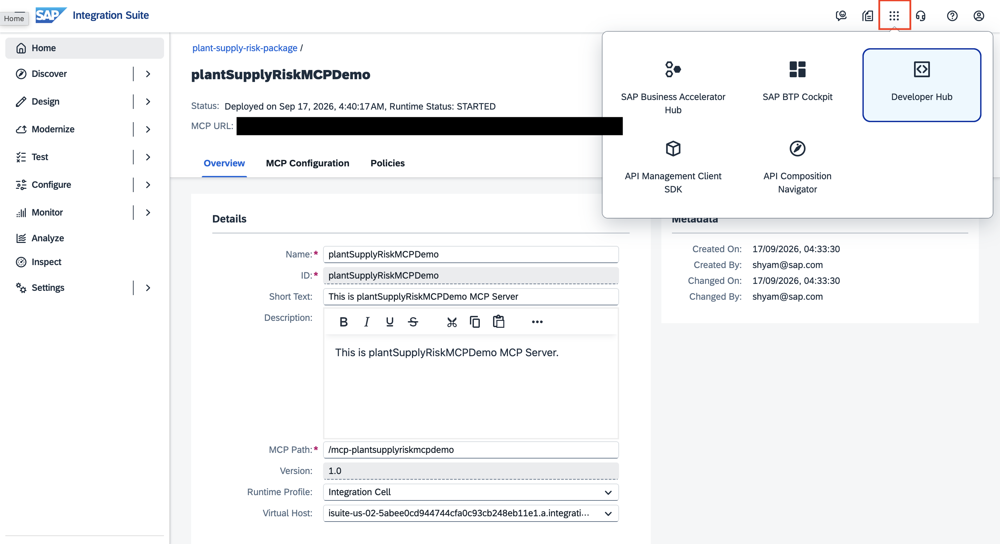

### Step 2 — Open Admin Center → Content

In the Developer Hub top navigation bar, click **Admin Center → Content**.

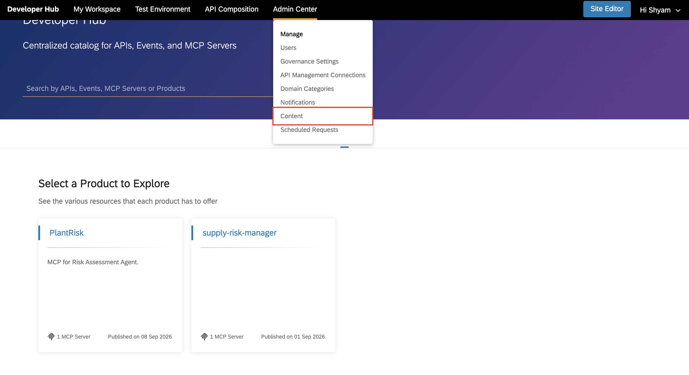

### Step 3 — Select Your Business System

On the **Manage Content** page, open the **Business Systems** tab.

Click on your Integration Suite business system to open it.

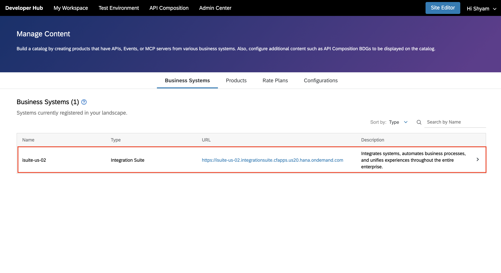

### Step 4 — Select the AI Artifacts (MCP Server)

Click the **AI Artifacts** tab. You will see a list of all deployed MCP Servers registered on this business system.

Select **`plantsupplyrisk_XX`** (replace XX with your assigned participant number) by checking the checkbox next to it.
Click **Create Product**

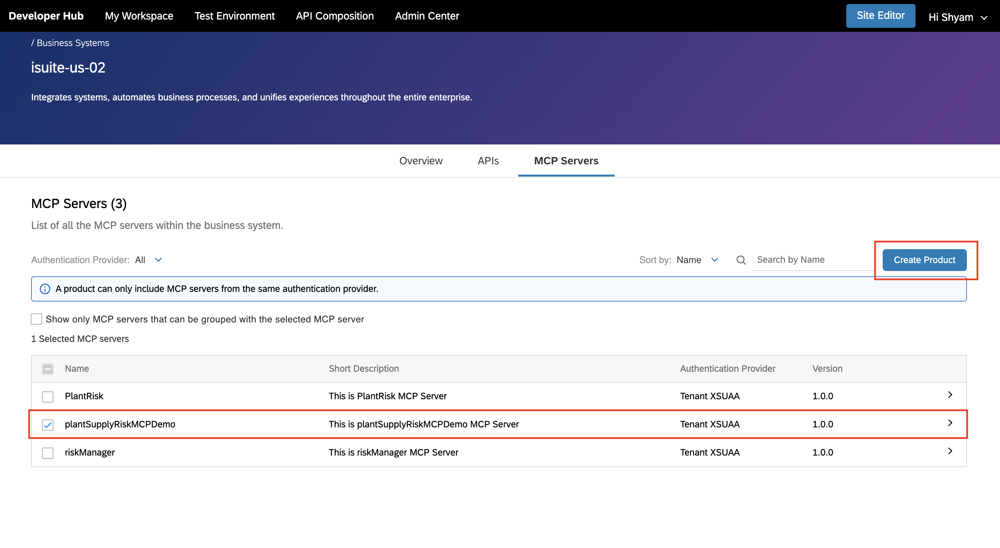

### Step 5 — Fill in Product Details and Publish

Fill in the following product details:

| Field | Value |
|---|---|
| Name | `plantsupplyriskProduct-XX` (replace XX with your assigned participant number) |
| ID | `plantsupplyriskProduct-XX` (replace XX with your assigned participant number) |
| Short Text | `The Plant Supply Risk MCP Artifact is deployed as a product` |
| Description | `The Plant Supply Risk MCP Artifact is deployed as a product` |

Click **Publish**

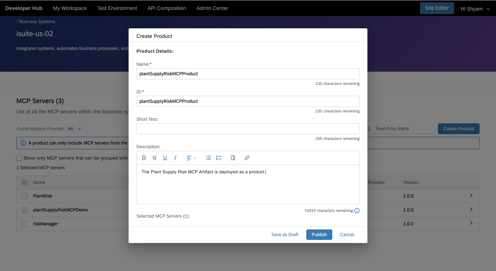

> [!NOTE]
> Publishing triggers an AI-assisted content creation process in the background. You can optionally monitor its progress via **Admin Center → Scheduled Requests**. Wait for the status to change to **Success** before subscribing.
>
> 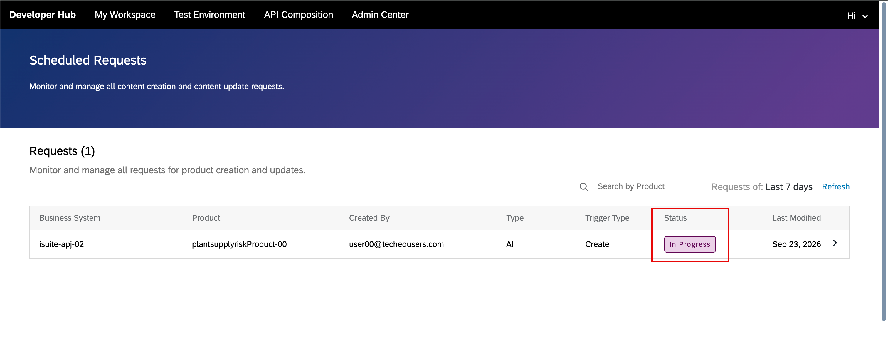
> 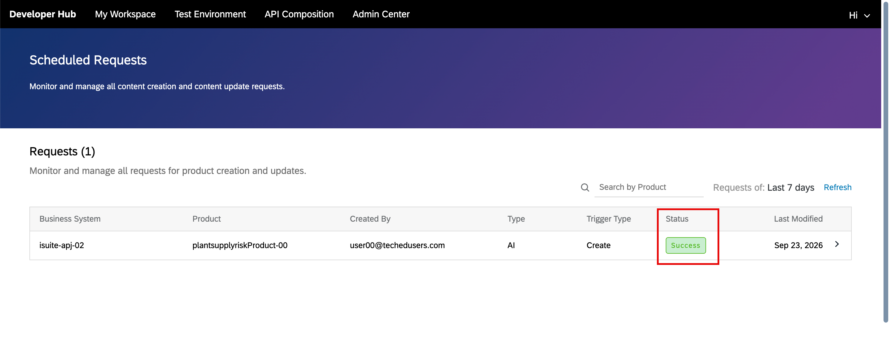

### Step 6 — Confirm the Product is Live

In the top navigation bar, click **Developer Hub** to return to the Developer Hub home page. Your product `plantsupplyriskProduct-XX` (replace XX with your assigned participant number) should appear in the catalog.

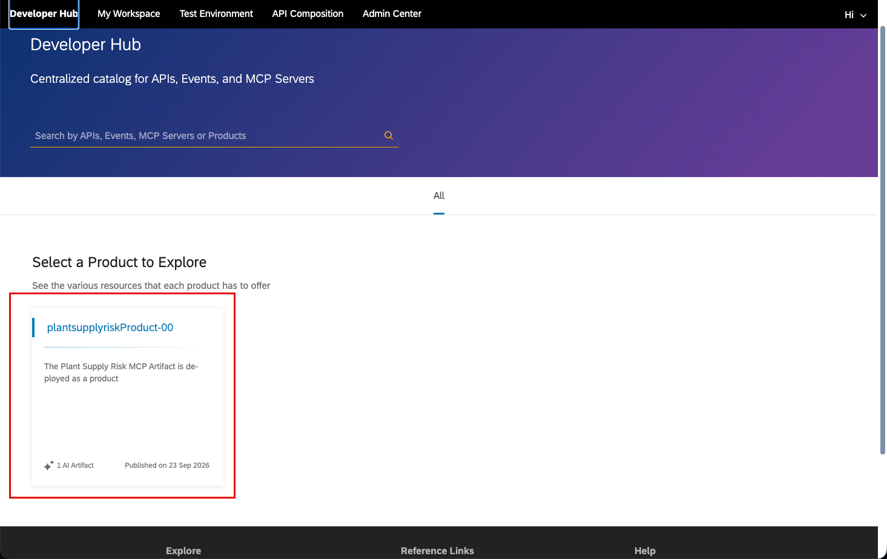

---

## Ex. 2.6 — Subscribe to the Product

### Step 1 — Open the Product and Subscribe

Click on **`plantsupplyriskProduct-XX` (replace XX with your assigned participant number)** from the Developer Hub catalog.

On the product detail page, click **Subscribe → Create New Subscription for Agent**.

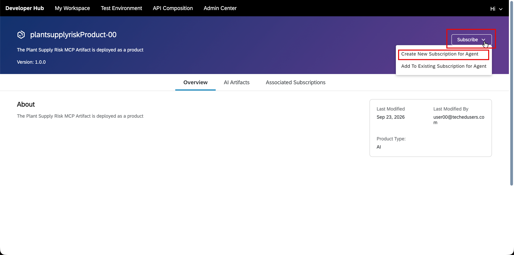

### Step 2 — Fill in Subscription Details

Fill in the subscription details:

| Field | Value |
|---|---|
| Name | `plantsupplyriskSubscription-XX` (replace XX with your assigned participant number) |
| Short Text | `Plant supply risk MCP product is subscribed` |
| Description | `Plant supply risk MCP product is subscribed` |

Click **Create**

> [!NOTE]
> Subscription finalization may take a short while. The credentials will become available once provisioning is complete. Proceed to Ex. 2.7 once the subscription appears in **My Workspace → Subscriptions → Agents**.

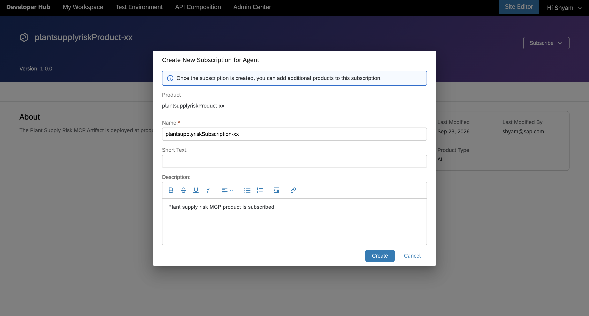

---

## Ex. 2.7 — Retrieve Credentials

### Step 1 — Open My Workspace

In the Developer Hub top navigation bar, click **My Workspace**.

On the **Subscriptions** page, click the **Agents** tab. You will see your newly created subscription `plantsupplyriskSubscription-XX` in the list.

Click on **`plantsupplyriskSubscription-XX`** (replace XX with your assigned participant number) to open it.

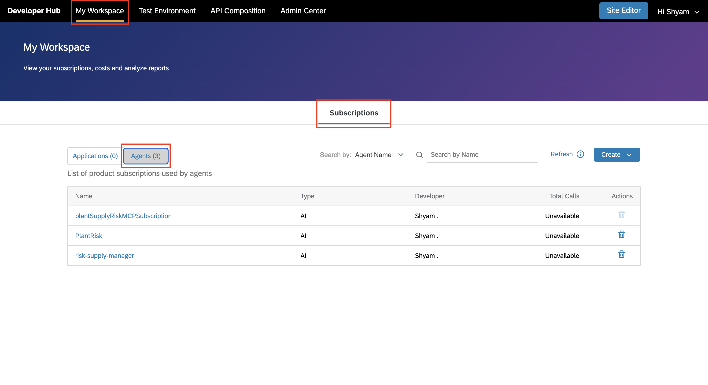

### Step 2 — Copy Your Credentials

On the subscription **Overview** page, locate the **Credentials** section.

Copy and save the following — you will need all three in [Ex. 3.1](../ex3/README.md#ex-31--connect-via-mcp-inspector):

| Credential | What it is |
|---|---|
| **Token URL** | OAuth token endpoint to exchange your credentials for a bearer token |
| **Key** | OAuth Client ID |
| **Secret** | OAuth Client Secret |

> [!NOTE]
> It may take a short while for the credentials to appear on the Overview page. If the Credentials section is not yet visible, refresh the page and try again.

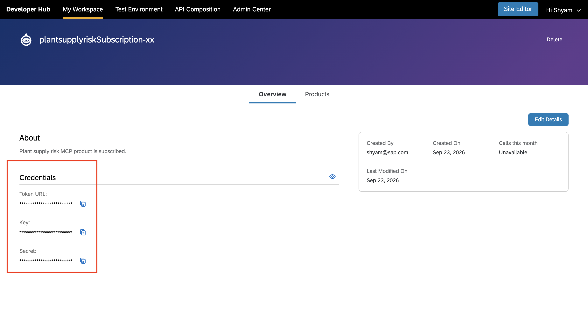

---

## Summary

In this exercise you:

- Created an **Integration Package** and added an **MCP Server** backed by the Business Data Graph OpenAPI Specification from Exercise 1
- Reviewed the default **Policy Model** — MCP Sender Adapter, Authentication, Authorization (`API.invoke`), and HTTP Receiver Adapter
- Extended the Policy Model with two **Traffic Management** policies — **Surge Protection** (3 calls per 9 seconds) and **Quota Management** (15 calls per day, tracked per OAuth Client ID)
- Deployed the MCP Server to **Integration Cell**, making the assessment tools available as a governed, live endpoint
- Published the MCP Server as a **product** (`plantsupplyriskProduct-XX`) in the Developer Hub
- Subscribed to the product (`plantsupplyriskSubscription-XX`) and retrieved the **OAuth credentials** (Token URL, Key, Secret) needed by AI agents

Your MCP Server is deployed, published, and ready to be governed. Continue to [Exercise 3](../ex3/README.md) to connect an MCP client, observe the traffic policies in action, and monitor consumption.

---

[Back to Overview](../../../../README.md)
