# Exercise 3 — Connect, Govern & Analyze an MCP Server using SAP Integration Suite

## Overview

Your MCP Server is deployed, published, and governed. Now it is time to connect an AI agent, observe how the traffic policies protect it in practice, and monitor the consumption patterns — all from within SAP Integration Suite.

In this exercise, you will connect the MCP Inspector as an MCP client using the OAuth credentials from [Exercise 2](../ex2/README.md), make live tool calls against the supply risk data, and deliberately test the Surge Protection and Quota policies you configured. You will then use Monitor Message Processing to inspect how each request — successful or rejected — was handled by the policy pipeline.

> [!IMPORTANT]
> You will need the **MCP URL** from Ex. 2.4 and the **OAuth credentials** (Token URL, Key, Secret) from Ex. 2.7 to complete this exercise. Have them ready before you begin.

---

## Ex. 3.1 — Connect via MCP Inspector

Any AI agent or MCP client can consume the MCP Server. For this workshop, your instructor has provided a hosted **MCP Inspector** (MCP Client) URL; open it in your browser.

### Step 1 — Add Your MCP Server

Click **Add Servers → + Add manually**.

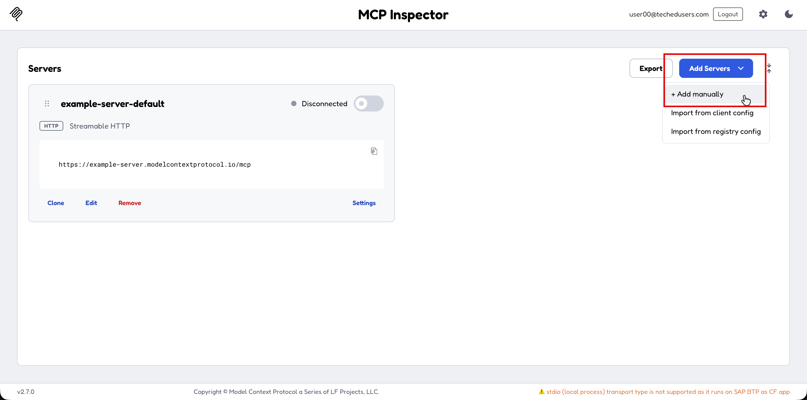

In the **Add server** dialog, fill in:

| Field | Value |
|---|---|
| Server ID | `plantsupplyrisk-mcp-XX` (replace XX with your assigned participant number) |
| Transport | `streamable-http` |
| URL | Your MCP URL from Ex. 2.4 (e.g. `https://<virtual-host>/mcp-plantsupplyrisk-XX`) |

Click **Add**

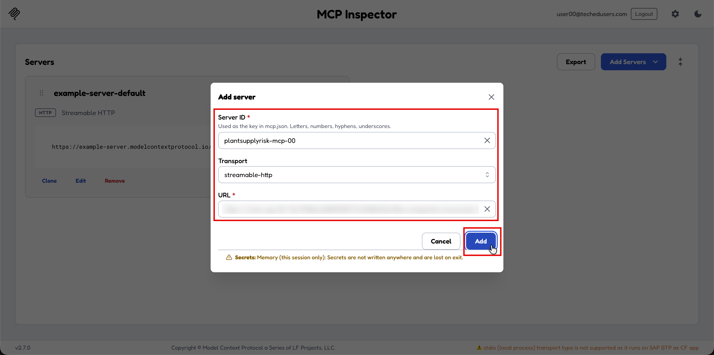

### Step 2 — Configure OAuth Authentication

On the server card, click **Settings**.

Scroll to the bottom of the Settings dialog and click **OAuth Settings** to expand it.

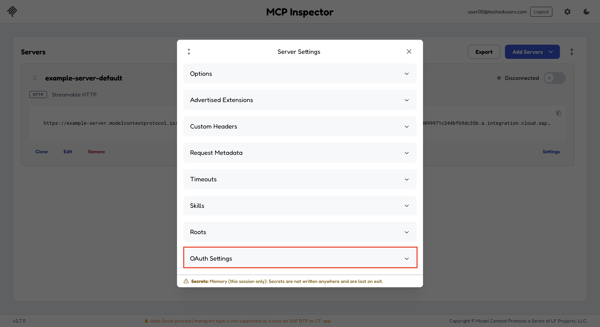

Configure the following fields:

| Field | Value |
|---|---|
| **Enterprise-managed authorization** | Leave **unchecked** |
| **Client ID** | Your **Key** from Ex. 2.7 |
| **Client Secret** | Your **Secret** from Ex. 2.7 |
| **Request refresh token** | **Uncheck** (checked by default) |
| **Revoke tokens on clear** | **Uncheck** (checked by default) |

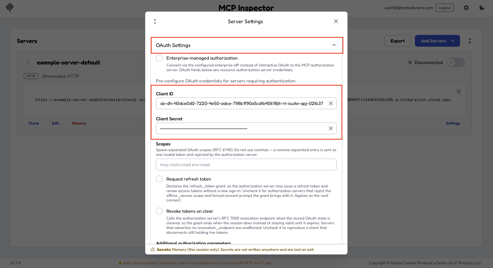

Scroll down within OAuth Settings to **Token URL override** and enter your **Token URL** from Ex. 2.7. Leave **Authorization URL override** blank.

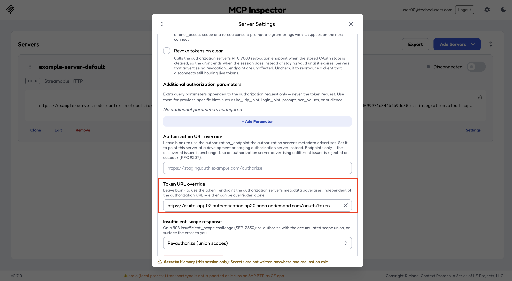

Close Settings.

### Step 3 — Connect and Observe Surge Protection in Action

Toggle the server switch to **Connected**. The server card turns green.

> [!IMPORTANT]
> Immediately click **Tools** in the top navigation bar — do this before reading further. You have a 9-second window to catch the Surge Protection response.

Look at the **Messages** panel on the right. You will see several entries timestamped at the same second — **TOOLS/LIST** and **RESOURCES/LIST** are shown as **PENDING**. Scroll down to see the two calls that passed: **INITIALIZE** and **NOTIFICATIONS/INITIALIZED**.

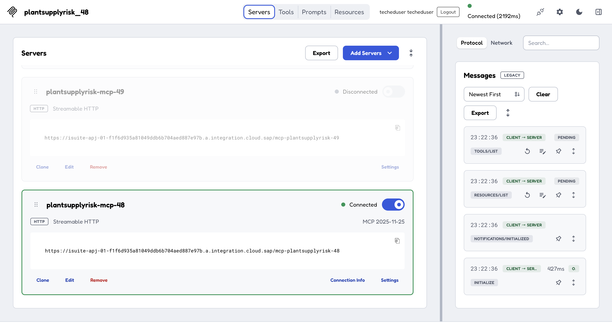
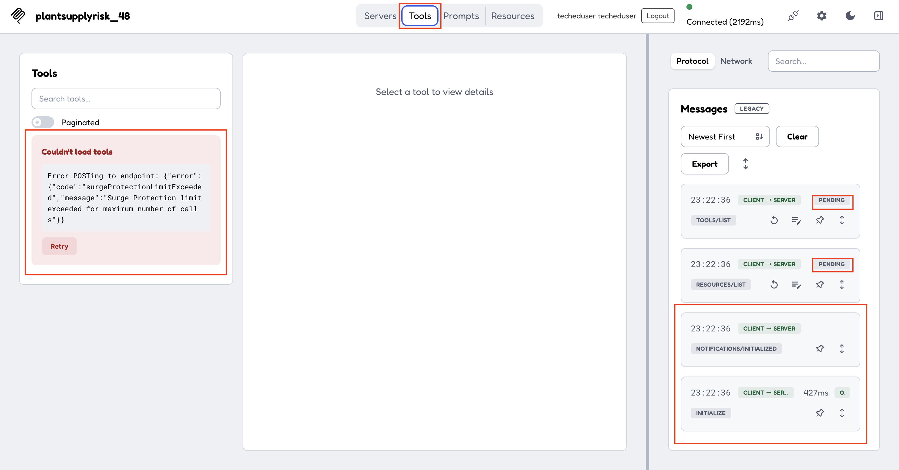

The Tools panel shows:

```
Couldn't load tools
Error POSTing to endpoint: {"error":{"code":"surgeProtectionLimitExceeded","message":"Surge Protection limit exceeded for maximum number of calls"}}
```

Now look at the **Messages** panel on the right.


When the connection was established, MCP Inspector automatically fired multiple protocol handshake requests simultaneously — to initialize the session, discover tools, list resources, and more. All arrived at the MCP Server within the same instant.

You will see several entries timestamped at the same second — **TOOLS/LIST** and **RESOURCES/LIST** are shown as **PENDING**. Scroll down to see the two calls that passed: **INITIALIZE** and **NOTIFICATIONS/INITIALIZED**.

> [!NOTE]
> You did not click anything — Surge Protection fired the moment the connection was established. The MCP Inspector's automatic handshake sent more than 3 requests within 9 seconds, and the policy stopped the rest before they reached the backend. This is exactly what Surge Protection does to an AI agent that floods the endpoint.

**Wait approximately 10 seconds** for the Surge Protection window to reset, then click **Tools** again. The 4 tools will now load successfully.

Click **Retrieve a list of assessment** (`get_bestrun_assessment`) — the parameter form opens in the center pane. No parameters are required — click **Execute Tool**.

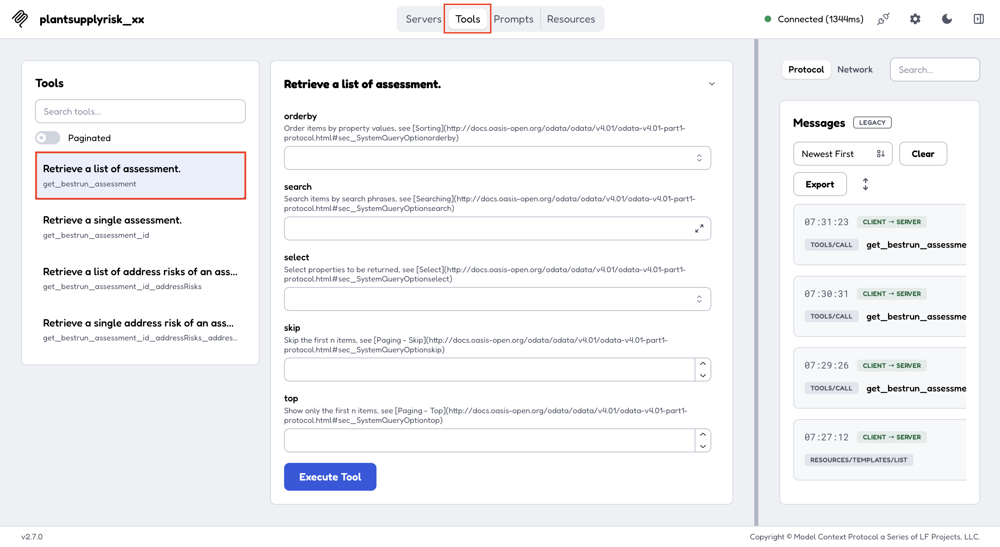

The Results pane shows all plants with their IDs (Berlin, Munich, London, etc.).

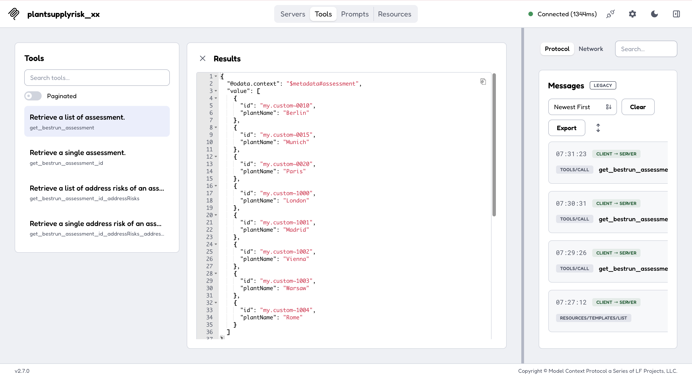

Pick `id` — **`my.custom~0010`** from the results and click **Retrieve a list of address risks of an assessment** (`get_bestrun_assessment_id_addressRisks`). Enter the `id` value in the **id** field.

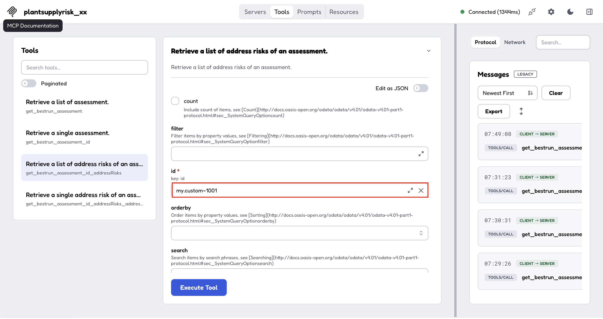

Click **Execute Tool** — this returns the live risk scores for that plant's location.

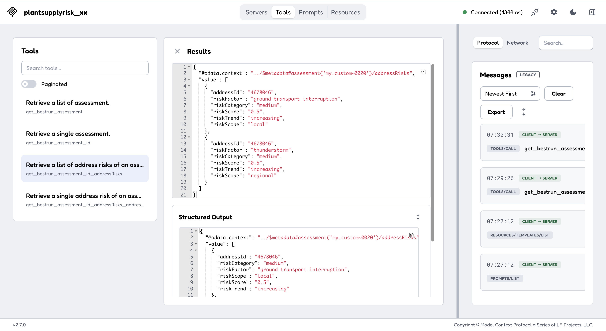

> **Tip:** The data you see here — plant IDs, risk factors, risk scores — is exactly what an AI agent will receive when it calls these tools autonomously to answer a procurement question.

> [!NOTE]
> The successful tool calls you make in this step count toward your daily Quota. Keep this in mind as you continue to Ex. 3.2.

### Troubleshooting

| Issue | Fix |
|---|---|
| Cannot connect | Verify the MCP URL matches the one shown in Ex. 2.4 |
| 401 Unauthorized | Verify Client ID, Client Secret, and Token URL are entered correctly in OAuth Settings |
| No tools listed | Ensure the correct tools were selected during Ex. 2.2 Step 4 |
| Issuer mismatch error | Ensure **Enterprise-managed authorization** is **unchecked** in OAuth Settings |

---

## Ex. 3.2 — Govern: Observe Traffic Policies in Action

With the MCP Inspector connected and initial tool calls made, you will now observe both Traffic Management policies in action. Before triggering any policy violations, you will first enable trace logging — this ensures that every subsequent request, whether successful or rejected, is captured in full detail for inspection in Ex. 3.3.

### Step 1 — Enable Trace Logging

In SAP Integration Suite, go to **Monitor → Integrations and APIs**. Set **Runtime** to **Integration Cell**.

Click the **Manage Integration Content** tile.

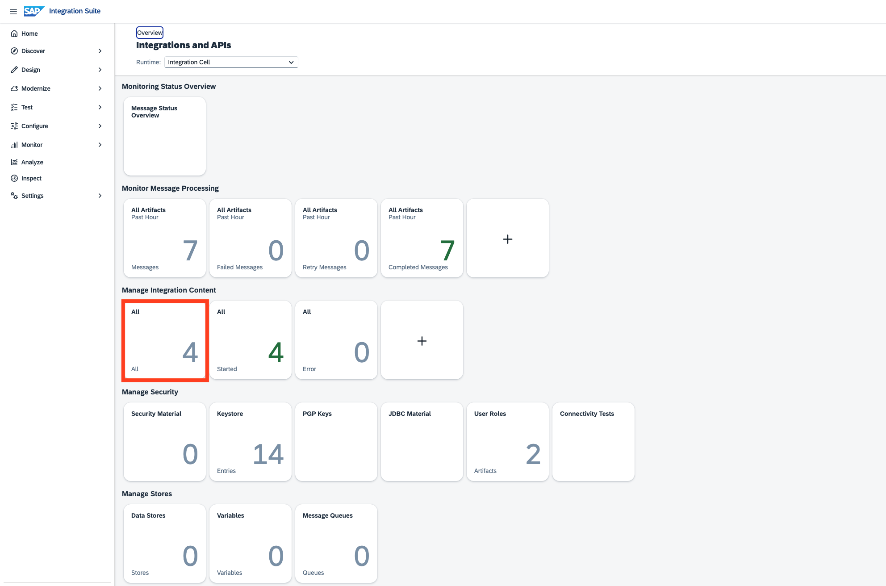

Set **Runtime** to **Integration Cell**. In the **Integration Content** list, click on **`plantsupplyrisk_XX`**.

In the right panel, scroll to **Log Configuration** and set the **Log Level** to **Trace**.

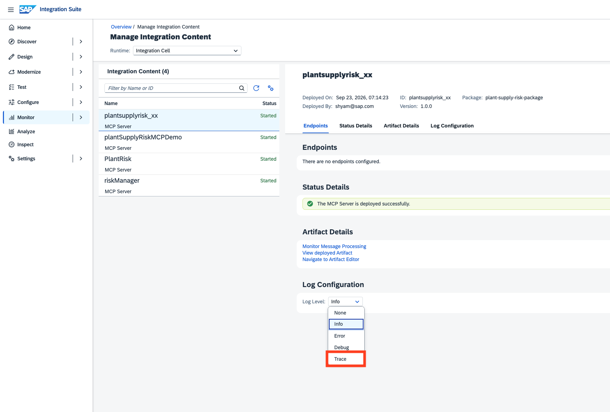

> [!NOTE]
> Trace logging captures full policy execution details and request/response payloads for every message processed. It is automatically reset after approximately 1 hour. Enabling it now ensures both the Surge Protection and Quota violations you trigger next are recorded with full detail.

Return to MCP Inspector before proceeding to the next step.

---

### Step 2 — Trigger the Traffic Policies

In the **Messages** panel, find any successful **TOOLS/CALL** entry. Click the **Replay** button (circular arrow icon) on that entry — this re-sends the exact same call instantly without filling in parameters again.

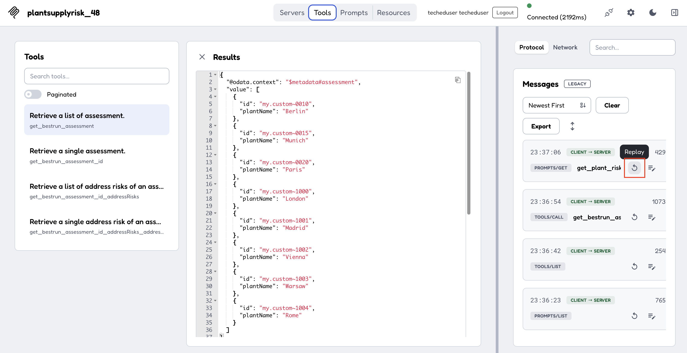

Keep clicking **Replay** rapidly. After 3 calls within the 9-second window, Surge Protection fires. A **Replay failed** popup appears at the bottom-right:

```
Replay failed
Error POSTing to endpoint: {"error":{"code":"surgeProtectionLimitExceeded","message":"Surge Protection limit exceeded for maximum number of calls"}}
```

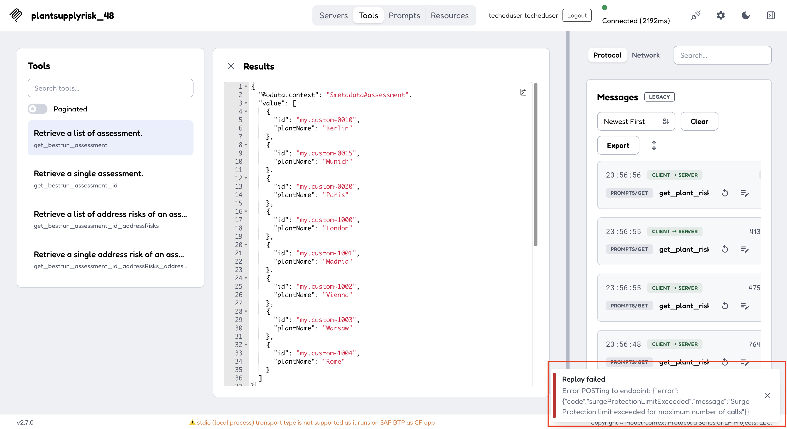

> [!NOTE]
> Surge Protection resets after the 9-second window expires. Wait approximately 10 seconds — the next Replay will succeed.

Continue replaying, spacing each call at least **10 seconds apart**. The successful calls from Ex. 3.1 already count toward your daily quota — keep going until the quota is exhausted. The **Replay failed** popup now shows:

```
Replay failed
Error POSTing to endpoint: {"error":{"code":"quotaExceeded","message":"Quota exceeded for maximum number of calls"}}
```

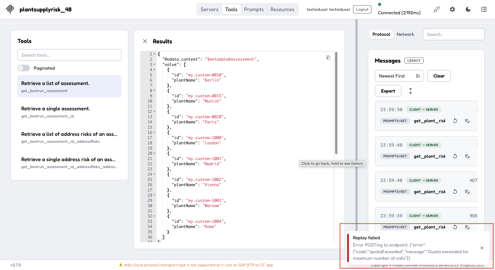

> [!NOTE]
> Unlike Surge Protection, Quota does not reset within the workshop session. Once exhausted, no further successful calls are possible until the next quota window opens.

With both policies triggered, proceed to Ex. 3.3 to analyze what was captured.

---

## Ex. 3.3 — Analyze: Monitor MCP Consumption

Every request processed by your MCP Server — successful or rejected — is recorded as a message in Monitor Message Processing. With trace logging enabled from Ex. 3.2, each message carries full policy execution detail. In this step you will inspect all three message types side by side and understand exactly what the policy pipeline did for each.

### Step 1 — Open Monitor Message Processing

In SAP Integration Suite, go to **Monitor → Integrations and APIs**.

Click the **Monitor Message Processing** tile.

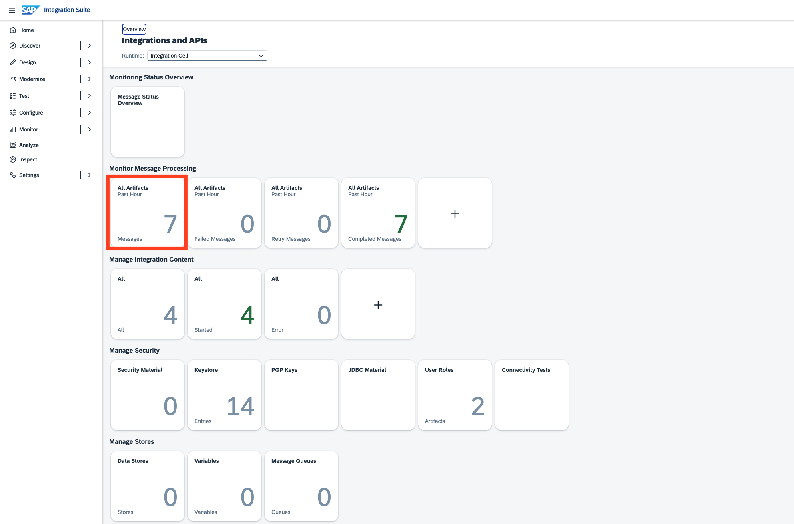

### Step 2 — View All Message Types

Set **Runtime** to **Integration Cell**. You will see a list of messages for `plantsupplyrisk_XX` — both completed and failed. The list reflects everything that happened across Ex. 3.1 and Ex. 3.2:

| Message Status | Origin | What happened |
|---|---|---|
| **Completed** | Ex. 3.1 tool calls | Request passed all policies and reached the backend |
| **Failed** | Surge Protection breach (Ex. 3.2) | Request was aborted at the Surge Protection step |
| **Failed** | Quota breach (Ex. 3.2) | Request was aborted at the Quota step |

Click on a **Completed** message row to open the detail panel.

The panel shows:
- **Status** — Message processing completed successfully
- **Processing Time**
- **Logs** — Log Level: Trace

Click **Trace**

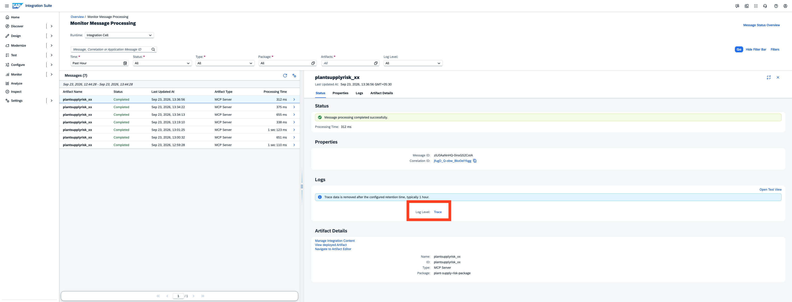

### Step 3 — Inspect Run Steps for a Successful Message

Click **MCP Server Model**.

The **Run Steps** panel shows each policy component and its execution time — **Authentication**, **Authorization 1**, **Surge Protection**, and **Quota** — all highlighted green, overlaid on the Policy Model diagram. This confirms the request passed through every policy and reached the backend.


### Step 4 — Inspect Run Steps for a Surge Protection Failure

Go back to the message list and click on a **Failed** message that corresponds to the Surge Protection breach.

In the **Run Steps** panel, the flow stops at the **Surge Protection** node — highlighted in red. Authentication and Authorization 1 completed successfully, but Surge Protection aborted the request before it reached Quota or the backend.


### Step 5 — Inspect Run Steps for a Quota Failure

Click on a **Failed** message that corresponds to the Quota breach.

In the **Run Steps** panel, the flow progresses further — Authentication, Authorization 1, and Surge Protection all completed — but stops at the **Quota** node. This reflects the order of the policy chain: Quota is only reached by requests that have already passed the burst check.


> [!NOTE]
> Comparing the three Run Steps diagrams side by side is the clearest way to understand how the policy chain works. Each policy acts as a gate — a request reaches the next gate only if it passes the current one. The Run Steps diagram shows exactly where each request stopped and why.

---

## Summary

In this exercise you:

- Connected the **MCP Inspector** to your MCP Server using OAuth credentials and verified all four tools are accessible
- Enabled **Trace logging** to capture full policy execution detail for all subsequent requests
- Triggered **Surge Protection** — observed the `surgeProtectionLimitExceeded` error when exceeding 3 calls within a 9-second window, and confirmed the policy resets after the window expires
- Triggered **Quota Management** — observed the `quotaLimitExceeded` error when the daily call allowance per OAuth Client ID was exhausted
- Used **Monitor Message Processing** to inspect all three message types — successful, Surge Protection failure, and Quota failure — and compared the **Run Steps** diagrams to see exactly which policy fired for each

The full MCP Server lifecycle is now complete: composed from enterprise APIs in Exercise 1, deployed and governed in Exercise 2, and connected, tested, and analyzed in Exercise 3.

---

[Back to Overview](../../../../README.md)
